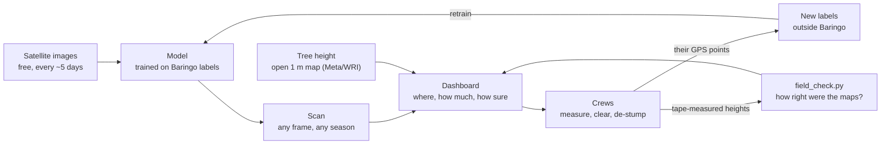
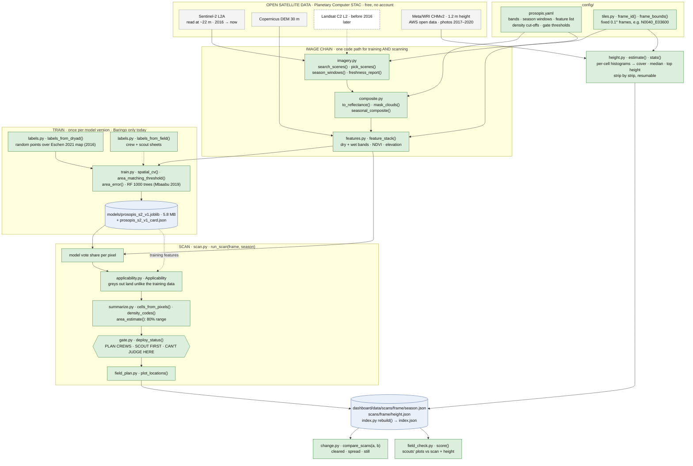
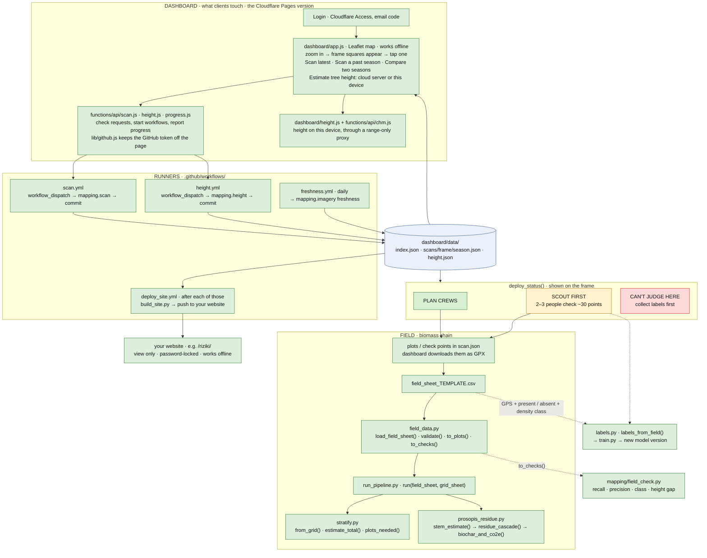
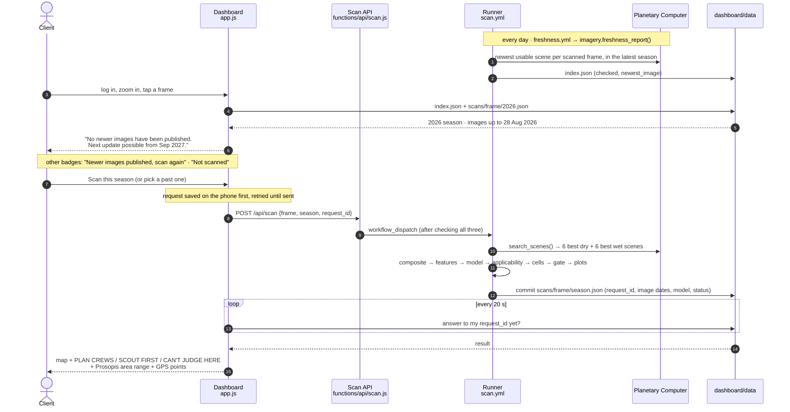
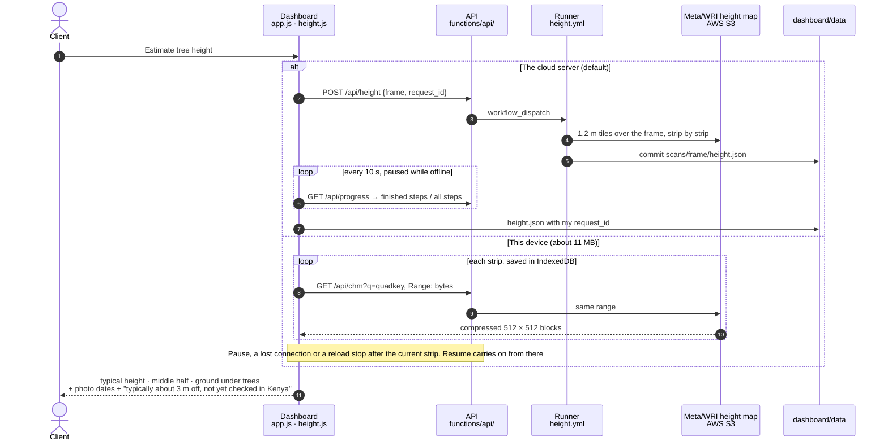

# Riziki · Prosopis mapping

Find where *Prosopis juliflora* is, how dense it is, and how sure we are, for any fixed 0.1° frame (about 11 × 11 km) in Kenya and any season from 2016 on. It reproduces the Random Forest method of Mbaabu et al. (2019), trained on their Baringo labels, and points it at new places and new dates. A scan's output decides where crews go, so every scan reports how much it can be trusted. It also refuses to give a "go" where the model is guessing. For the same cells it adds a tree-height and canopy-cover estimate from the open Meta/WRI 1 m height map, labelled with its photo dates and typical error.

## How it fits together



## 1 · The mapping engine

Everything lives in `mapping/`, one job per file. Green boxes are built and have been run on real 2016 and 2026 imagery.



## 2 · From a scan to the field



## 3 · What happens when a client clicks Scan



## 4 · Estimate tree height



## Run it

```bash
pip install -r requirements.txt
# labels: download the shapefile bundle (.shp .shx .dbf .prj) from
# https://doi.org/10.5061/dryad.4xgxd258c into data/labels/
python -m mapping.train                                  # ~3 min; writes models/
python -m mapping.scan --frame N0040_E03600 --season 2026 --tif   # ~75 s
python -m mapping.change N0040_E03600 2016 2026          # cleared / spread / still, in ha
python -m mapping.imagery freshness                      # what the daily job does
python -m mapping.imagery list N0040_E03600 2026         # which scenes a scan would use
python -m mapping.height N0040_E03600                    # ~20 s; Ctrl-C and run again to resume
python -m mapping.field_check sheets/*.csv               # scouts' plots vs the maps
python tools/build_site.py ../my-site/riziki             # view-only, password-locked copy for a website
```

## Model v1 results

`models/prosopis_s2_v1_card.json` has the full record. Trained on the 2016 season (Jan–Mar + Apr–Aug 2016 Sentinel-2) against the Eschen et al. 2021 map, 7,960 random points:

| Measure (held-out ~2 km blocks) | Value |
|---|---|
| Overall agreement with the 2016 map | 89.1% (kappa 0.55) |
| Of the map's Prosopis, share the model finds | 61% |
| Of what the model calls Prosopis, share that is | 61% |
| Every pixel of every held-out block | 89.0% agree |
| True Prosopis area ÷ mapped area, ~3,000 ha windows | 0.79–1.23 in 8 of 10 windows |
| Strongest features | dry-season near-infrared, elevation, wet-season near-infrared, dry-season NDVI |

What the numbers mean for crews: pixel by pixel the map is a guide, not an answer. **Areas** are much better than pixels, which is why scans report Prosopis hectares as a range. It's also why everything starts at SCOUT FIRST.

**A lesson learned, now built in.** The first version trained on "clean" interior points, 50/50 Prosopis and not. It scored 93.5% on points like those, but on every pixel it mapped 55% too much Prosopis. Random points over the whole mapped area, plus a vote cut-off chosen so mapped area matches true area, fixed the bias. They also lowered the headline number to its honest value. The same check is now part of `train.area_error()`.

Example scans (`dashboard/data/`). Marigat frame N0040_E03600:
- 2016: 4,100–6,373 ha of Prosopis. Dryad's own count for that frame, about 4,770 ha, sits inside the range.
- 2026: 3,915–6,085 ha.
- 2016 → 2026: 823 ha cleared and 1,372 ha of new spread.

The lake-edge frame N0060_E03600 has 106–164 ha. Every one of these is SCOUT FIRST: no region has been checked on the ground yet.

## Scripts

| File | Functions | Status |
|---|---|---|
| `config/prosopis.yaml` | bands, season windows, features, labels, model, density cut-offs, gate, field plan | exists |
| `mapping/tiles.py` | `frame_id()` `frame_bounds()` `in_region()` `cell_ha()`: must match `app.js` | exists |
| `mapping/imagery.py` | `catalog()` `season_windows()` `latest_season()` `search_scenes()` `pick_scenes()` `freshness_report()` | exists |
| `mapping/composite.py` | `to_reflectance()` `mask_clouds()` `load_scenes()` `seasonal_composite()` | exists |
| `mapping/features.py` | `feature_names()` `feature_stack()` `load_elevation()` | exists |
| `mapping/labels.py` | `labels_from_dryad()` `rasterize_dryad()` `labels_from_field()` `add_blocks()` | exists |
| `mapping/train.py` | `train()` `spatial_cv()` `area_matching_threshold()` `area_error()` | exists |
| `mapping/applicability.py` | `Applicability.fit()` `.di()` `.inside()` | exists |
| `mapping/summarize.py` | `cells_from_pixels()` `density_codes()` `density_ha()` `area_estimate()` | exists |
| `mapping/gate.py` | `deploy_status()` | exists |
| `mapping/field_plan.py` | `plot_locations()` | exists |
| `mapping/change.py` | `compare_scans()` | exists |
| `mapping/height.py` | `run()` `estimate()` `stats()` `units()`: tree cover and height per cell from Meta/WRI CHMv2 (1.2 m, open), resumable, written to `scans/<frame>/height.json` | exists |
| `mapping/field_check.py` | `run()` `map_values()` `score()`: scouts' plots vs scan class and height; writes `data/field_check.json` | exists |
| `mapping/index.py` | `rebuild()` | exists |
| `mapping/scan.py` | `run_scan()` `write_failure()` | exists |
| `models/` | `prosopis_s2_v1.joblib` + `_card.json` | trained |
| `dashboard/` | map, status, scan requests, compare, GPX, tree height, offline | exists (DEMO until `API_URL` is set; `VIEW_ONLY` for a plain static host) |
| `dashboard/lock.js` | `ready()` `open()` `forget()`: asks for the password and decrypts `data/` (AES-GCM, PBKDF2) | exists |
| `dashboard/height.js` | `run()` `stats()` `imageDates()`: the browser twin of `height.py`, same numbers, resumable from IndexedDB | exists |
| `functions/api/` | `scan.js` `height.js` (`POST`) · `progress.js` (`GET`, run steps) · `chm.js` (`GET`, range-only proxy to the height map) | exists |
| `lib/github.js` | `dispatch()` `progress()`: the one place the GitHub token is used | exists |
| `.github/workflows/` | `scan.yml` and `height.yml` on request; `freshness.yml` daily; `deploy_site.yml` after each of them | exists, not yet run on GitHub |
| `tools/publish_results.sh` | pull, rebuild index, commit, push, retry: used by both request workflows | exists |
| `tools/make_demo_data.py` | sample data in `dashboard/data_demo/` | exists |
| `tools/check_density_cutoffs.py` | density cut-offs vs a dense/sparse reference map: per-class shares, precision of thick, best-fit cut-offs | exists |
| `tools/build_site.py` | view-only copy for a static host; encrypts `data/` with a password; keeps unchanged files byte for byte | exists |
| `tools/deploy_site.sh` | build, commit and push to one folder of the website's repo, retrying if someone pushed first | exists |
| `run_pipeline.py` `stratify.py` `prosopis_residue.py` `field_data.py` | field sheet → biomass → residue → CO2e; `to_checks()` feeds `field_check.py` | exists |
| `Riziki_1_tkc/SEPIELLBK_Reprod1.ipynb` | the Earth Engine reproduction | reference only |

## Rules the code keeps

- **One feature function.** Training and scanning both call `feature_stack()`. The model stores its feature list, and `run_scan()` refuses a model whose list doesn't match.
- **"Most recent" means the latest complete season, not the latest photo.** The model tells evergreen Prosopis from deciduous *Vachellia* by the dry-versus-wet contrast. Season *Y* is the dry season (Jan–Mar *Y*) plus the wet season (Apr–Aug *Y*). The paper paired each dry season with the wet season before it, for Landsat reasons. On Sentinel-2 the 2015 wet season covers 0.2% of Baringo, so seasons pair within the year. A season can be scanned from September.
- **One catalog for training and scanning.** Planetary Computer is the only open catalog found with Sentinel-2 surface reflectance over Baringo for 2016. The reprocessed "Collection 1" on Earth Search and Digital Earth Africa has nothing there before 2020, despite ESA's published dates.
- **Scenes that cover the frame come first.** A tile is imaged from two orbits, and one of them often misses the frame even at 0% cloud.
- **Reflectance is harmonized.** `to_reflectance()` removes the +1000 offset ESA added from processing baseline 04.00 (Jan 2022). Skip it and before/after comparisons show change that isn't there.
- **Accuracy is spatial and representative.** `spatial_cv()` holds out whole ~2 km blocks, on random points. `area_error()` checks every pixel. The paper's 98% came from random CV on pixels from the same hand-drawn polygons.
- **Every pixel is checked against the training data.** `Applicability` greys out pixels whose features look like nothing the model was trained on (Meyer & Pebesma 2021).
- **Failures still answer.** If a scan fails, `write_failure()` still publishes a result with the reason and the request id. A failed re-scan keeps the last good scan and says so.
- **Height is an estimate and says so.** The dashboard shows the photo dates behind it and the published error (about 3 m against lidar, Brandt et al. 2026), and that it has not been checked in Kenya. It counts every tree, so it is summed over the cells the scan maps as Prosopis.
- **Same height numbers wherever it runs.** `height.py` and `dashboard/height.js` bin pixels the same way. On a real frame they agree on all 30,000 per-cell values.
- **Every scan is a record.** `scan.json` keeps the scene ids, model id and tested accuracy, applicability, clear share and gate status. Any deployment can be traced back to what the map said.

## Deploy status

`gate.deploy_status()`. Thresholds are placeholders in `config/prosopis.yaml` until set with Riziki and Purity.

| Status | Rule | What the client does |
|---|---|---|
| PLAN CREWS | ≥ 90% of clear pixels on familiar ground · latest season · frame in `validated_regions` | send the team with the plot GPX |
| SCOUT FIRST | anything short of that, with ≥ 70% familiar and ≥ 80% clear | 2–3 people visit the 30-odd random check points |
| CAN'T JUDGE HERE | < 70% familiar, < 80% clear, or the scan failed | don't deploy on this map |

`validated_regions` is empty, so even Baringo starts at SCOUT FIRST. One scout trip whose check points agree with the map unlocks a frame.

## Beyond Baringo: our own labels

1. Every crew or scout visit doubles as labelling. Fill `field_sheet_TEMPLATE.csv` with GPS on every plot, the `density_class` (thick, medium, thin or none), `cover_pct`, the dashboard point it visits (`map_point`) and, for each plant, `height_m` with `height_method`. Write `stem_status = none` for plots with no Prosopis. Log cleared or de-stumped areas with dates. `field_data.py` checks all of it.
2. Scout check points come from `field_plan.plot_locations()`. They're random within each map class and never used for training, which keeps the accuracy honest. `python -m mapping.field_check` scores the maps against them. Aim for 50+ per class over time, then replace the Baringo-based range, and the worldwide height error, with numbers from those points (Olofsson et al. 2014).
3. `labels_from_field()` → `train.py` → a new model version and card. The area of applicability grows into the new region, and the frame goes into `validated_regions` once its check points pass.
4. Data that already exists, to ask for:
   - Purity's reference point locations. Tables S6–S10 of the paper's supplement are in `data/reference/mbaabu2019_reference_samples.csv` (CC BY 4.0), but they only count samples per class and year (2016: 88 Prosopis, 476 in the lowland subset, from field work Oct 2015–Jun 2016; earlier years from Google Earth imagery). The points themselves appear only as maps (Figures S1–S5), so ask her for the coordinates.
   - the 215 points behind Cherotich et al. (2026, ILRI)
5. Before scanning Turkana, test `static: []` (no elevation). Turkana sits hundreds of metres below every training point. In Baringo, dropping elevation costs only ~0.04 kappa.
6. Density cut-offs, checked against the 2016 dense/sparse map in the Dryad package (`sublocations_mgmt_scenarios.shp`: 2,720 ha dense and 1,798 ha sparse around Marigat; `python tools/check_density_cutoffs.py`). Over 10,461 cells:
   - The map calls 85% of the reference's dense cells thick. Of the cells it calls thick, 64% are dense, 18% sparse and 18% have no Prosopis.
   - Sparse stands are the weak spot: 56% of them come out thick and only a third as thin or medium. No pair of cut-offs does better: the best fit (thin 0.02, thick 0.51) scores 0.67 against 0.66 now, and raising thick to 0.70 loses 18 points of dense for 3 points of precision. The mean model vote per cell didn't separate them either.
   - So the cut-offs stay as they are, and "thick" should be read as "dense or sparse Prosopis, mostly dense". The reference is itself a 2016 satellite product from the same team whose polygons trained the model, so this is a consistency check, not a field test. Rerun it with crews' by-eye classes when they exist.

## Adding another plant

1. Copy `config/prosopis.yaml` to `config/<plant>.yaml`. Set the bands, season windows and features where the plant differs most from its neighbours (the phenology argument), plus its label source and cut-offs. Give it a new `model_id`.
2. Collect labels with the same field sheet.
3. `python -m mapping.train --config config/<plant>.yaml`. `scan.py` reads the config, so nothing else in `mapping/` changes.
4. Biomass is species-specific. A new plant needs its own allometry module next to `prosopis_residue.py`.

## Dashboard

`dashboard/` is plain HTML and JavaScript with no build step. `config.js` is the only file to edit. With `API_URL` empty, scan and height requests are simulated and a DEMO banner shows; the stored scans and height estimates in `data/` are real. Sample data in the same format sits in `data_demo/`. With `VIEW_ONLY: true` it shows the stored maps only: no scan or tree-height buttons, no banner, and only the seasons there is a map for. `LOCKED` is set by `tools/build_site.py`.

**What it reads.** `scan.py` and the workflows write these files.
- `data/index.json` holds `latest_season`, `next_update` and `checked`. For each frame it also holds `scans`, `status`, `images_to` and `newest_image`.
- `data/scans/<frame>/<season>.json` is one scan. It holds:
  - `status` and `status_reasons`
  - `images` {`dry`, `wet`, `to`, `ids`}, `model`, `applicability` and `valid_share`
  - `cell_ha`, `area_ha` {`prosopis`, `low`, `high`} and `density_ha`
  - `grid` {`n`, `codes`} and `plots`
  - `request_id`, plus `failed` or `refresh_failed` when something went wrong
- `grid.codes` is 100 × 100 characters, row by row from the north-west corner: `0` none, `1` thin, `2` medium, `3` thick, `9` can't judge. One scan is about 16 KB.
- In a locked copy every one of these files is `{"riziki_locked": 1, "z": 1, "iv", "data"}`: the JSON, compressed, AES-256-GCM encrypted, base64. `data/lock.json` holds the salt, the PBKDF2-SHA256 rounds (600,000) and an encrypted check value.
- `data/scans/<frame>/height.json` is one height estimate: `request_id`, `method` (cloud, device or computer), `source`, `accuracy` {`mae_m`, `checked_in_kenya`}, `image_dates` {date: share of the frame} and `grid` {`n`, `cover` (%), `tree_m`, `top_m`}. These are per-cell lists in the same order as `codes`, with `null` where there's no data. It's about 100 KB, or 15 KB compressed. `index.json` marks frames that have one with `height`, the newest photo date.

**What it sends.** `POST /api/scan` with `{frame, season, request_id}`. `POST /api/height` with `{frame, request_id}`. `GET /api/progress?job=height&request_id=…` for the progress bar. On This device, `GET /api/chm?q=<quadkey>` with a `Range` header for the height tiles, and `?meta=<quadkey>` for their photo dates.

**On bad internet**
- `sw.js` keeps the page, the last data it saw and recently viewed map tiles, so the page opens with no signal.
- The selected area, season and comparison are in the URL and on the phone, so a reload puts you back where you were.
- A scan request is saved on the phone before it's sent. It retries by itself and is picked up again after a reload. Results are matched by `request_id`.
- The last 12 areas opened work offline. GPS lists are made on the phone itself.
- When an answer comes from the saved copy, the header says "Weak connection" or "Offline".
- A tree-height run is saved too. On the cloud server it keeps going whatever the phone does, and the bar catches up later. On This device it pauses by itself when the connection drops, keeps finished strips in IndexedDB, and carries on after a reload.

Bump `VERSION` in `sw.js` whenever you change a dashboard file. `build_site.py` stamps the website copy's `VERSION` with a hash of its files, so that copy needs no bump.

## Hosting

The same `dashboard/` folder runs in two ways.

| | Your website (GitHub Pages) | Cloudflare Pages |
|---|---|---|
| Clients see | the stored maps, tree height, comparisons, GPS lists, offline | the same, plus Scan and Estimate tree height buttons |
| New scans | run from this repo's Actions tab ("Run workflow"); the website updates itself | clients press Scan |
| Who can open it | anyone with the password | listed emails (Cloudflare Access) |
| Set up | the steps below, once | the steps further down |

### Put the map on your website

The website's repo gets one folder, such as `riziki/`. After every scan, tree-height run and daily freshness check, `deploy_site.yml` rebuilds that folder (view only, data encrypted) and pushes it. Nothing else in the website's repo is touched, and the website never calls back here. Change the dashboard in this repo: edits made inside the website's `riziki/` are overwritten by the next push.

1. **A deploy key** (a key that can push to the website's repo and nothing else). On your computer:
   `ssh-keygen -t ed25519 -C riziki-deploy -N "" -f riziki_deploy`
   - In the **website** repo: Settings → Deploy keys → Add deploy key. Paste `riziki_deploy.pub` and tick "Allow write access".
   - In **this** repo: Settings → Secrets and variables → Actions → New repository secret `SITE_DEPLOY_KEY`. Paste all of `riziki_deploy`. Then delete both files from your computer.
2. **The password.** In this repo, add the secret `RIZIKI_PASSWORD`: at least 10 characters; a few words together is easiest to share and hardest to guess.
3. **Where it goes.** In this repo, Variables tab: `SITE_REPO` = the website repo (`owner/name`) and `SITE_DIR` = `riziki`. Add `SITE_BRANCH` only if the website publishes from a branch other than its default. Plain HTML and Jekyll sites need nothing more; if a tool such as Astro or Vite builds the website, put the map in the folder it copies as is: `SITE_DIR` = `public/riziki`.
4. **First copy.** Actions → "deploy site" → Run workflow. Then open `https://<your domain>/riziki/` and enter the password.
5. In the website repo's Pages settings, keep **Enforce HTTPS** on. Over plain http the page can't decrypt and says so.

To build by hand instead: `python tools/build_site.py ../my-site/riziki`, then commit and push the website. It asks for the password twice (or reads `RIZIKI_PASSWORD`), and refuses a folder that holds files it didn't write.

**What the lock does.** Each data file is AES-256-GCM encrypted with a key made from the password (PBKDF2-SHA256, 600,000 rounds), so someone who finds the link or downloads the files gets nothing readable. The page asks once per device and remembers it until someone presses **Lock**, which also clears the maps saved on that device. It doesn't protect the page's code (it's public), stop someone who has the password from passing it on, or hold up against a short password tried many times. To shut people out, change `RIZIKI_PASSWORD` and run "deploy site": every device is asked again. The same password on a rebuild keeps everyone in.

### Cloudflare Pages, with the buttons

1. **Cloudflare Pages**, connected to this repo. Root directory: repo root. Build output directory: `dashboard`. `functions/` at the repo root becomes `/api/scan`, `/api/height`, `/api/progress` and `/api/chm` on the same site. They import `lib/github.js`. Check all four on the first deploy.
2. **Environment variables** in Pages: `GITHUB_TOKEN` and `GITHUB_REPO` = `dreamteam-tahreemkarim/riziki_tkconsult`. The token is fine-grained, limited to this repo, with "Actions: read and write".
3. **Cloudflare Access** on the whole site, listing allowed emails. It's free for up to 50 users, and clients sign in with a one-time code from their email, so no GitHub accounts are needed.
4. **Switch off DEMO mode:** set `API_URL: "/api"` in `dashboard/config.js`.

GitHub's own private Pages needs GitHub Enterprise Cloud and a GitHub account for every viewer; the encrypted website copy above needs neither. The runner can later move to AWS Batch at national scale, and `scan.py` stays the same.

## Sources

- Mbaabu et al. 2019, *Remote Sensing* 11:1217: https://doi.org/10.3390/rs11101217
- Eschen et al. 2021, Dryad (CC0), Baringo `PSINCE` polygons: https://doi.org/10.5061/dryad.4xgxd258c
- Cherotich et al. 2026, *Ecologies* 7:20: https://doi.org/10.3390/ecologies7010020
- Paliwal et al. 2024, *Plants* 13:1868: https://doi.org/10.3390/plants13131868
- Meyer & Pebesma 2021, area of applicability, *Methods Ecol Evol*: https://doi.org/10.1111/2041-210X.13650
- Ploton et al. 2020, spatial validation, *Nature Communications*: https://doi.org/10.1038/s41467-020-18321-y
- Olofsson et al. 2014, area and accuracy, *Remote Sens Environ*: https://doi.org/10.1016/j.rse.2014.02.015
- Brandt et al. 2026, CHMv2 canopy height, arXiv: https://arxiv.org/abs/2603.06382
- Meta/WRI CHMv2 open data (CC BY 4.0): https://registry.opendata.aws/dataforgood-fb-forestsv2/
- Microsoft Planetary Computer, Sentinel-2 L2A: https://planetarycomputer.microsoft.com/dataset/sentinel-2-l2a
- ESA, L2A offset from PB 04.00: https://sentinel.esa.int/web/sentinel/technical-guides/sentinel-2-msi/level-2a-algorithms-products
- GitHub, Pages custom domains and verification: https://docs.github.com/en/pages/configuring-a-custom-domain-for-your-github-pages-site/verifying-your-custom-domain-for-github-pages
- GitHub, private Pages: https://docs.github.com/en/enterprise-cloud@latest/pages/getting-started-with-github-pages/changing-the-visibility-of-your-github-pages-site
- Cloudflare Access pricing: https://www.cloudflare.com/products/zero-trust/access/
